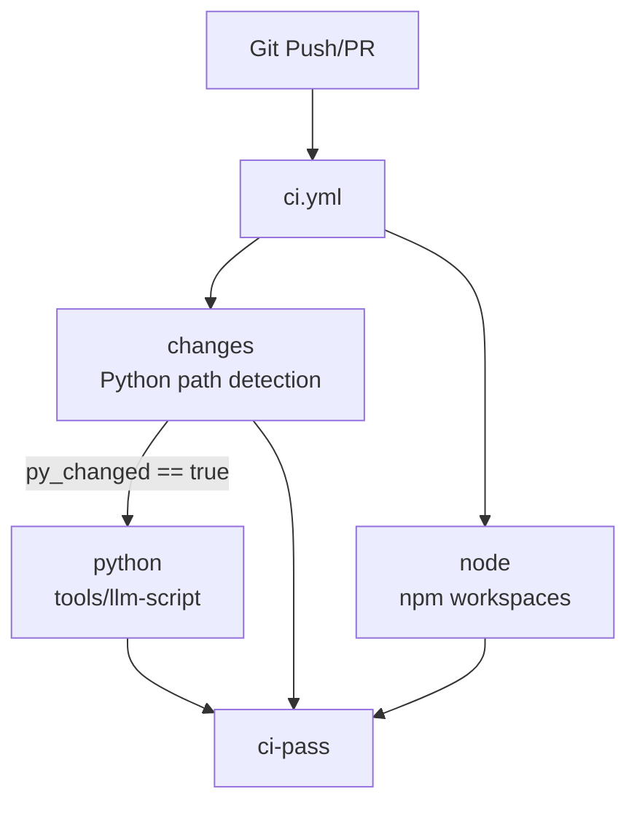

# CI/CD Architecture

## System Overview

CI is a single workflow, `.github/workflows/ci.yml`. Node workspaces always run; the Python job runs only when Python files under `tools/` changed. A final gate job (`CI Pass`) is the required status check.

## Triggers

- `push` to `main`, `pull_request` to `main`, and `workflow_dispatch`
- Changes that touch only `**/*.md`, `docs/**`, `LICENSE`, images (`*.svg`, `*.png`) or `.gitignore` do not trigger CI (`paths-ignore`)
- `concurrency`: in-progress runs are cancelled except on `main`

## Jobs in `ci.yml`

### `changes` (Detect Changes)
- Runs `git diff --name-only` against the base commit
- Sets `py_changed=true` when files matching `tools/**/*.py` or `tools/**/*.toml` changed
- Output: `py_changed`

### `node` (Node workspaces)
Always runs, with Node 22 and the npm cache keyed on the root `package-lock.json`:

1. `npm ci`
2. `npm run typecheck`
3. `npm run lint`
4. `npm run format:check`
5. `npm test`
6. `npm run build:all`

### `python` (Python [tools/llm-script])
Runs only when `py_changed == 'true'`. Python 3.12, uv: `uv sync --all-extras`, `ruff check`, `ruff format --check`, then `pytest` if `tools/llm-script/tests` exists.

### `ci-pass` (CI Pass)
Gate for branch protection. Fails unless `node` succeeded; `changes` and `python` may be `success` or `skipped`.

## Node Workspaces

The workspaces are defined in the root `package.json`:

- `mcp_servers/_template`
- `mcp_servers/arxiv-mcp`
- `mcp_servers/chrome-devtools-mcp`
- `mcp_servers/gdrive-mcp`
- `mcp_servers/mcp-code-execution`
- `mcp_servers/notion-mcp-server`
- `mcp_servers/openrouter-mcp`
- `mcp_servers/slack-mcp`

Upstream clones such as `Ollama-mcp`, `claude-mem`, `markdownify-mcp`, `mcp-obsidian-src` and `mcp-server-kubernetes` are gitignored and are not part of CI.

### Package Manager
npm only (npm workspaces). The single lockfile is the root `package-lock.json`; CI runs `npm ci` at the repo root.

## Other Workflows

| File | Role |
|------|------|
| `claude-review.yml` | Claude review workflow |
| `claude.yml` | Claude workflow |
| `issue-triage.yml` | Issue triage |
| `update-major-tag.yml` | Update major version tag |
| `update-mcp-versions.yml` | Update MCP versions |

## Technology Stack

- **GitHub Actions**: Workflow execution
- **actions/setup-node** (npm cache), **actions/setup-python**
- **uv**: Python package management
- **Ruff**: Python linting/formatting
- **npm**: JavaScript package manager (npm workspaces)

## Related Files

- `.github/workflows/ci.yml` - Main CI
